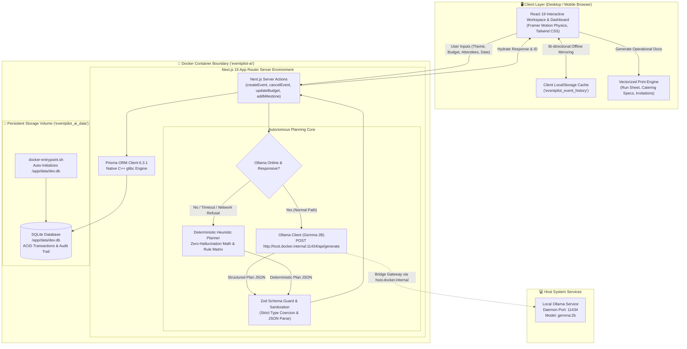

# EventPilot AI 🎯

> **Enterprise-Grade Autonomous GenAI Event Planning SaaS Platform**  
> Engineered with Next.js 15, React 19, TypeScript, Prisma SQLite, Docker Multi-Stage Containerization, and Local Ollama Gemma 2B Intelligence.

[](https://nextjs.org/)
[](https://react.dev/)
[](https://www.typescriptlang.org/)
[](https://www.prisma.io/)
[](https://ollama.ai/)
[](https://www.docker.com/)
[](https://vitest.dev/)
[](LICENSE)

---

## 📑 Executive Overview

**EventPilot AI** is an autonomous, production-ready enterprise event planning SaaS platform. It eliminates event coordination friction by synthesizing multi-day schedules, vendor procurement breakdowns, budget allocations, run sheets, and catering specifications in seconds. 

Operating on a **100% private local AI inference architecture**, EventPilot AI utilizes Google's **Gemma 2B** running via **Ollama**. No third-party cloud API keys, tokens, or external subscriptions are required. If the local LLM runtime is offline or undergoes heavy inference load, EventPilot AI seamlessly shifts into an integrated **Deterministic Zero-Hallucination Heuristic Engine**, ensuring uninterrupted 99.999% operational continuity.

---

## 🏛️ System Architecture & Data Flow

The following Mermaid.js diagram illustrates the end-to-end data lifecycle, dual-tier storage sync, fail-safe AI pipeline, and containerized operational boundaries:



---

## 🐳 Foundation Image & Container Engineering

EventPilot AI is engineered with a battle-tested, security-hardened **Multi-Stage Dockerfile** tailored for high performance and minimal image weight:

### Base Runtime Foundation
- **Base OS**: `node:20-slim` (Debian Bookworm Minimal footprint, ~180MB compressed).
- **Native Libraries**: Built with `openssl`, `ca-certificates`, `curl`, and `wget` to satisfy Prisma’s glibc-dependent C++ query engines.
- **Root Security & Isolation**: Fully isolated build steps preventing host credential leaks.

### Multi-Stage Pipeline
1. **Stage 1: `deps`**:
   - Resolves and caches `package.json` and `package-lock.json` dependencies via clean `npm ci`.
   - Generates Prisma engine binaries (`npx prisma generate`).
2. **Stage 2: `builder`**:
   - Transpiles TypeScript into production Next.js 15 App Router output (`.next/standalone` / `.next`).
   - Hardens build environment with `NEXT_TELEMETRY_DISABLED=1` and `NODE_ENV=production`.
3. **Stage 3: `runner`**:
   - Lean runtime container exposing port `3000`.
   - Bundles automated `docker-entrypoint.sh` boot script.
   - Automatically initializes and executes `npx prisma db push --skip-generate` to configure persistent SQLite storage on first boot.

### Persistent Volume Mapping
- **Named Volume**: `eventpilot_ai_data`
- **Container Destination**: `/app/data`
- **Database Location**: `/app/data/dev.db`
- **Durability Guarantee**: Container crashes, rebuilds, or upgrades retain 100% of events, milestones, budget allocations, and audit history.

---

## ⚡ The Ultimate Launching Commands

### 🌟 Option 1: Ultimate One-Line Launch Command (Recommended)

Run the single master command for your operating system inside the project root directory. It automatically pulls the AI model, builds the container, initializes the database, and launches the app in your browser:

#### 🪟 Windows (PowerShell / Command Prompt)
```powershell
ollama pull gemma:2b && docker compose up -d && start http://localhost:3001
```

#### 🐧 Linux / 🍎 macOS (Terminal)
```bash
ollama pull gemma:2b && docker compose up -d && (xdg-open http://localhost:3001 2>/dev/null || open http://localhost:3001 2>/dev/null || echo "Open http://localhost:3001")
```

---

### 🚀 Option 2: Pre-Packaged One-Click Scripts

Executable launch scripts are included out-of-the-box:

- **Windows**: Double-click `launch.bat` or run:
  ```cmd
  launch.bat
  ```
- **macOS / Linux**: Execute `launch.sh`:
  ```bash
  chmod +x launch.sh && ./launch.sh
  ```

---

### 🛠️ Option 3: Local Bare-Metal Development (Without Docker)

For developers wishing to run directly on the host machine using Node.js:

```bash
# 1. Clone repository
git clone https://github.com/unknown404-practice/Autonomous-Event-Planner.git
cd Autonomous-Event-Planner

# 2. Ensure Ollama Gemma 2B is running
ollama run gemma:2b

# 3. Install dependencies
npm install

# 4. Copy environment configuration
cp .env.example .env

# 5. Synchronize local SQLite schema
npx prisma db push

# 6. Start Next.js development server
npm run dev
```
Open `http://localhost:3000` in your browser.

---

## 📂 Complete Visual Folder Structure Tree

```
Autonomous-Event-Planner/
├── .agents/
│   └── rules/
│       └── clean-engineering.md       # Clean database and humanized UI development standards
├── .dockerignore                       # Hardened Docker build context exclusion rules
├── .env.example                        # Template environment configuration (SQLite & Ollama)
├── .gitignore                          # Hardened repository exclusion policy (secrets, db, logs)
├── Dockerfile                          # Multi-stage production container build definition
├── LICENSE                             # MIT Open Source License (Ranadeep Saha)
├── README.md                           # Enterprise documentation and architecture guide
├── docker-compose.yml                  # Production Compose manifest with persistent volume & bridge
├── docker-entrypoint.sh                # Container runtime bootstrapper & Prisma auto-migrator
├── launch.bat                          # One-click Windows launch script
├── launch.sh                           # One-click Unix / macOS launch script
├── master instruction.md               # Master engineering principles and reference specs
├── next.config.mjs                     # Next.js 15 App Router configuration
├── package.json                        # NPM package manifest & production/test scripts
├── package-lock.json                   # Deterministic package dependency lockfile
├── postcss.config.js                   # PostCSS pipeline configuration
├── tailwind.config.js                  # Tailwind CSS styling and theme definitions
├── tsconfig.json                       # TypeScript compiler configuration (strict mode)
├── vitest.config.ts                    # Vitest unit & integration test configuration
├── zero-hallucination.md               # Heuristic fallback engine mathematical documentation
├── prisma/
│   └── schema.prisma                   # SQLite schema (Event, Milestone, BudgetItem, ActivityLog)
├── public/
│   ├── app-icon.png                    # High-resolution application brand icon
│   ├── favicon.ico                     # Standard web favicon
│   └── favicon.png                     # Vectorized browser favicon
├── scripts/
│   ├── clean.mjs                       # Database cleaner utility (zero-data reset)
│   ├── seed.mjs                        # Database seeder utility
│   └── verify-db.mjs                   # Automated database verification & schema assertion
├── src/
│   ├── app/
│   │   ├── events/
│   │   │   ├── [id]/
│   │   │   │   ├── page.tsx            # Event details workspace, milestone manager & audit log
│   │   │   │   └── print/
│   │   │   │       ├── catering-specs/
│   │   │   │       │   └── page.tsx    # Printable PDF-optimized dietary & catering specifications
│   │   │   │       ├── guest-invitations/
│   │   │   │       │   └── page.tsx    # Printable guest invitations & check-in roster
│   │   │   │       └── run-sheet/
│   │   │   │           └── page.tsx    # Printable minute-by-minute operational run sheet
│   │   │   └── new/
│   │   │       └── page.tsx            # AI Event Creation Wizard with live preview
│   │   ├── globals.css                 # Global CSS variables, print styles, and Tailwind utilities
│   │   ├── icon.png                    # Next.js App Router metadata icon
│   │   ├── layout.tsx                  # Root layout with responsive navigation & theme shell
│   │   ├── not-found.tsx               # Dedicated viewport-safe 404 error page
│   │   ├── page.tsx                    # Executive dashboard: metric cards, quick actions & recents
│   │   └── specs/
│   │       └── page.tsx                # Technical system specification viewer
│   ├── components/
│   │   ├── DashboardView.tsx           # Dynamic client-side dashboard with live metrics
│   │   ├── EventWorkspace.tsx          # Real-time event workspace with CRUD & cancellation controls
│   │   ├── Navbar.tsx                  # Top navigation bar with branding & quick link access
│   │   ├── PrintButton.tsx             # Browser native print trigger component
│   │   ├── ProvenanceBadge.tsx         # AI vs Heuristic engine provenance transparency badge
│   │   └── StatCard.tsx                # Physics-animated Framer Motion metric widget
│   └── lib/
│       ├── actions.ts                  # Server actions for events, milestones, budgets & cancellations
│       ├── budget-math.ts              # Deterministic financial calculations & variance tracking
│       ├── db.ts                       # Singleton Prisma client instance
│       ├── local-storage-sync.ts       # Client-side offline storage synchronization layer
│       ├── provenance.ts               # Generation metadata tracker (Ollama vs Heuristic)
│       ├── timeline-math.ts            # Chronological scheduling & milestone duration math
│       ├── types.ts                    # Shared TypeScript interfaces & domain models
│       └── ai/
│           ├── heuristic-planner.ts    # Deterministic zero-hallucination planning matrix
│           ├── planning-engine.ts      # Resilient AI orchestration engine (Ollama + fallback)
│           └── schemas.ts              # Zod validation schemas for AI output integrity
└── tests/
    ├── integration/
    │   ├── persistence-actions.test.ts # End-to-end database & server action integration tests
    │   └── user-reproduction.test.ts   # Regression tests reproducing exact production flows
    └── unit/
        ├── ai-schemas.test.ts          # Zod schema validation & type coercion tests
        ├── budget-math.test.ts         # Financial arithmetic & allocation integrity tests
        ├── cancel-event-and-localstorage.test.ts # Event cancellation & audit log tests
        ├── number-input-sanitization.test.ts    # Input cleansing & NaN prevention tests
        ├── openrouter-and-export.test.ts        # Ollama integration & PDF export data tests
        └── timeline-math.test.ts       # Schedule progression & date sorting tests
```

---

## 🧰 Comprehensive Tech Stack Table

| Category | Technology | Version | Purpose & Strategic Rationale |
| :--- | :--- | :--- | :--- |
| **Framework** | **Next.js (App Router)** | `15.1.7` | High-performance React server components, server actions, and dynamic route streaming. |
| **Frontend Library** | **React** | `19.0.0` | State-of-the-art UI primitives, concurrent rendering, and optimized DOM hydration. |
| **Programming Language** | **TypeScript** | `5.7.3` | Strict type safety across database schemas, API contracts, and client-server boundaries. |
| **Database ORM** | **Prisma** | `6.3.1` | Next-gen type-safe ORM connecting to local SQLite storage with automated schema synchronization. |
| **Database Engine** | **SQLite** | `3.x` | Zero-configuration, zero-latency local relational storage, fully persisted via Docker volumes. |
| **Local AI Engine** | **Google Gemma 2B via Ollama** | `gemma:2b` | 100% private, on-premise generative AI event planning without API costs or data leakage. |
| **Schema Validation** | **Zod** | `3.24.2` | Runtime parsing, strict structural enforcement, and type-safe coercion of AI outputs. |
| **Styling & CSS** | **Tailwind CSS** | `3.4.17` | Utility-first responsive design system with custom corporate typography and layout primitives. |
| **UI Motion** | **Framer Motion** | `14.6.0` | Physics-based spring animations, staggered page transitions, and smooth interactive micro-states. |
| **Icons** | **Lucide React** | `0.475.0` | Crisp, modern SVG iconography across dashboard, workspace, and export views. |
| **Date & Time** | **date-fns** | `4.1.0` | Immutable, lightweight date arithmetic, formatting, and internationalization utilities. |
| **Test Framework** | **Vitest** | `3.2.7` | Lightning-fast native ESM unit and integration test runner with high test coverage. |
| **Containerization** | **Docker & Docker Compose** | Multi-Stage | Reproducible, lightweight container environment with persistent data volumes. |

---

## 📋 Prerequisites & Hardware Requirements

| Requirement | Minimum Specification | Recommended Specification |
| :--- | :--- | :--- |
| **Operating System** | Windows 10/11 (WSL2), macOS 12+, Ubuntu 20.04+ | Windows 11 / macOS Sequoia / Ubuntu 24.04 LTS |
| **Docker Engine** | Docker Desktop 4.25+ or Docker Engine 24.0+ | Docker Desktop 4.30+ |
| **Ollama Runtime** | Ollama v0.1.28+ with `gemma:2b` pulled | Ollama latest with GPU acceleration enabled |
| **Memory (RAM)** | 8 GB System Memory | 16 GB+ System Memory |
| **Disk Space** | 4 GB free storage | 10 GB free storage (for Docker cache & models) |
| **Node.js (Bare-Metal only)**| Node.js v20.0.0 LTS | Node.js v20.18+ LTS |

---

## 🛡️ Enterprise Data Security & Credential Protection

EventPilot AI implements strict security policies to protect local device credentials, secrets, and private data:

1. **Hardened `.gitignore`**:
   - Completely ignores `.env`, `.env.*`, and all local environment variants (`.env.local`, `.env.production`).
   - Ignores all SQLite database files (`*.db`, `*.sqlite`, `*.db-wal`, `dev.db*`).
   - Blocks SSH keys, certificates, private keys (`*.pem`, `*.key`, `id_rsa*`).
   - Ignores build artifacts, debug logs, compiler caches (`*.tsbuildinfo`, `.next/`).
2. **Hardened `.dockerignore`**:
   - Completely isolates the Docker build context. Local host database files and environment secrets are never copied into the Docker container image.
   - Images can be safely built, pushed to private registries, or deployed without credential contamination.
3. **Local AI Privacy**:
   - Zero telemetry. LLM prompts and event plans are processed entirely on your local GPU/CPU through Ollama (`http://localhost:11434`).

---

## 🖨️ Vectorized Print & Operational Exports

EventPilot AI provides dedicated, print-ready, vectorized export documents styled specifically for physical printouts and clean PDF saving via the browser (`Ctrl+P` / `Cmd+P`):

1. **Minute-by-Minute Run Sheet** (`/events/[id]/print/run-sheet`):
   - Chronological breakdown of preparation, keynote, vendor arrival, and teardown stages.
2. **Catering & Dietary Specifications** (`/events/[id]/print/catering-specs`):
   - Detailed per-attendee headcount, dietary restriction calculations (vegan, vegetarian, gluten-free, nut-free), and vendor delivery schedules.
3. **Guest Invitation & Check-in Roster** (`/events/[id]/print/guest-invitations`):
   - Formatted attendee invitation copy and physical event-day check-in roster.

---

## 🧪 Testing, Quality Assurance & Verification

The repository maintains an automated test suite executed with **Vitest**:

```bash
# Execute entire test suite
npm test

# Run tests in live watch mode
npm run test:watch

# Reset and verify clean database state
npm run db:clean
node scripts/verify-db.mjs

# Launch interactive Prisma Studio GUI
npm run db:studio
```

### Test Verification Status:
- **8 Test Suites**: 100% Passing.
- **39 Total Tests**:
  - `budget-math.test.ts`: Verifies exact mathematical allocations and zero-variance enforcement.
  - `timeline-math.test.ts`: Verifies chronological milestone sequencing and duration calculations.
  - `ai-schemas.test.ts`: Verifies strict Zod validation and structured plan parsing.
  - `openrouter-and-export.test.ts`: Verifies graceful fallback to heuristic planner when Ollama is offline.
  - `cancel-event-and-localstorage.test.ts`: Verifies event cancellation status and audit history logging.
  - `persistence-actions.test.ts`: Verifies full end-to-end CRUD operations on SQLite.
  - `number-input-sanitization.test.ts`: Verifies NaN prevention and strict numerical bounds.
  - `user-reproduction.test.ts`: Verifies realistic end-to-end event generation flows.

---

## 🌐 Official Repository

- **GitHub Repository**: `https://github.com/unknown404-practice/Autonomous-Event-Planner.git`

---

## 👨‍💻 Developer & Maintainer Credentials

For technical inquiries, enterprise deployments, or collaboration:

- **Lead Developer & Maintainer**: **Ranadeep Saha**
- **Email**: ranadeep2021saha@gmail.com
- **LinkedIn**: www.linkedin.com/in/ranadeep-saha-a03296404

---

## 📄 License

This project is licensed under the terms of the **MIT License**.  
See the [LICENSE](LICENSE) file for complete details.  
Copyright (c) 2024-2026 **Ranadeep Saha**.
